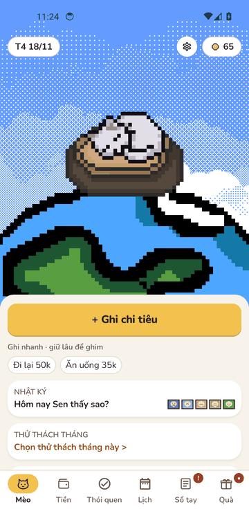
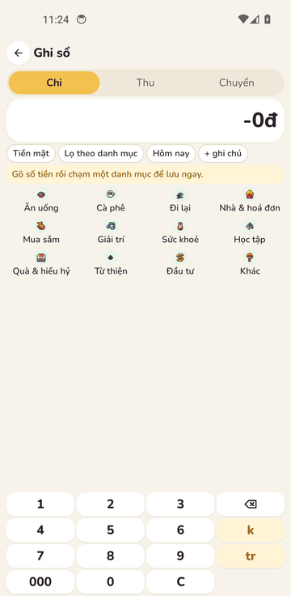
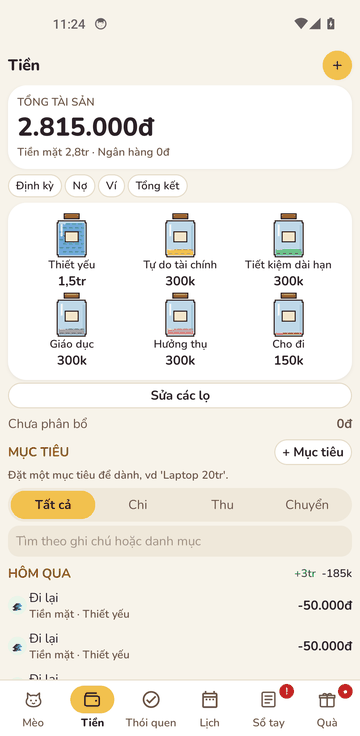
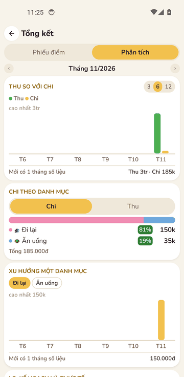
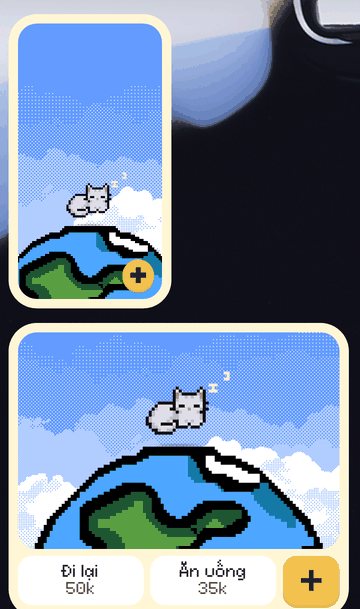
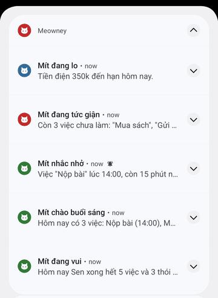

# Meowney

<div align="center">


-3DDC84?style=for-the-badge&logo=android&logoColor=white)


**Sổ tiền theo quy tắc 6 chiếc lọ, thói quen, lịch và sổ tay, có một con mèo pixel sống cùng.**

</div>

| Màn chính | Ghi sổ | Tiền | Phân tích | Widget | Thông báo |
|:-:|:-:|:-:|:-:|:-:|:-:|
|  |  |  |  |  |  |

---

## Mục lục

- [Giới thiệu](#giới-thiệu)
- [Có gì mới ở 1.1](#có-gì-mới-ở-11)
- [Tính năng](#tính-năng)
- [Sáu chiếc lọ chạy thế nào](#sáu-chiếc-lọ-chạy-thế-nào)
- [Kiến trúc](#kiến-trúc)
- [Cấu trúc thư mục](#cấu-trúc-thư-mục)
- [Dữ liệu](#dữ-liệu)
- [Cài đặt và chạy](#cài-đặt-và-chạy)
- [Kiểm thử](#kiểm-thử)
- [Art pipeline](#art-pipeline)
- [Ghi công](#ghi-công)
- [Lộ trình](#lộ-trình)
- [Vấn đề đã biết](#vấn-đề-đã-biết)

---

## Giới thiệu

Meowney là app Android cá nhân, viết bằng Kotlin và Jetpack Compose. Mỗi đồng tiền vào được chia vào các lọ theo tỉ lệ đặt sẵn; mỗi khoản chi lấy ra từ đúng lọ của nó. Bên cạnh tiền, app có thói quen, lịch, sổ tay và nhật ký, gom về một màn chính có con mèo pixel. Mèo vui khi bạn ghi sổ, lo khi có lọ bị âm, giận khi việc quá hạn, và nhắn tin cho bạn qua thông báo.

Không có tài khoản, không có máy chủ: dữ liệu nằm trong máy, sao lưu bằng một file `.zip` do bạn tự cất.

---

## Có gì mới ở 1.1

| Thay đổi | Mô tả |
|---|---|
| Mèo trên hành tinh | Phòng tròn được thay bằng một hành tinh nhỏ giữa bầu trời nhiều lớp trôi chậm, trời ngày và trời đêm đổi theo giờ |
| Mèo lười, biết gừ gừ | Ngủ theo giờ (8–12h và 21–4h), đi vài bước rồi nằm chỗ khác; vuốt ve thì ngáp, liếm lông và gừ gừ |
| Thanh điều hướng 6 mục | Mèo · Tiền · Thói quen · Lịch · Sổ tay · Quà, luôn ở dưới màn hình |
| Trang chủ mới | Hành tinh ở trên, các thẻ trong ngày ở dưới: hoá đơn, nhật ký, thói quen, lịch, ghi chú ghim, đã tiêu hôm nay |
| Lịch Ngày / Tuần / Tháng | Nhớ chế độ xem lần trước; Tuần có mục tiêu tuần |
| Quà còn 4 tab | Vòng quay · Cửa hàng (gộp Tủ đồ) · Tự thưởng · Thành tích (gộp thử thách tháng) |
| Chữ Nunito | Chữ đọc và bấm dùng Nunito, font pixel chỉ để trang trí |

---

## Tính năng

### Tiền và các lọ
| Tính năng | Mô tả |
|---|---|
| Ví | Tiền mặt, ngân hàng, ví điện tử; đặt ví mặc định, ẩn ví, điều chỉnh số dư thật |
| 6 chiếc lọ | Thiết yếu, Tự do tài chính, Tiết kiệm dài hạn, Giáo dục, Hưởng thụ, Cho đi; đổi tên và % được |
| Ghi sổ | Bàn phím có `k` (nghìn), `tr` (triệu), `000`; gõ số rồi chạm danh mục là lưu |
| Rót thu nhập | Khoản thu chia vào lọ theo %, chỉnh từng lọ trước khi rót |
| Lọ mượn lọ | Lọ không đủ tiền thì mượn lọ khác; khoản thu sau trả nợ lọ trước |
| Mục tiêu | Mục tiêu để dành bên trong lọ tiết kiệm, tự trích % mỗi khoản thu, mốc 25/50/75/100% có thưởng |
| Nợ | Cho vay, đi vay, ghi từng lần trả |
| Khoản định kỳ | Tiền nhà, điện, Netflix… theo tháng, tuần, năm; nhắc khi đến hạn |
| Lịch sử | Tổng tài sản, lọc Chi/Thu/Chuyển, tìm theo ghi chú hoặc danh mục |

### Tổng kết và phân tích
| Tính năng | Mô tả |
|---|---|
| Phiếu điểm tháng | Hạng S/A/B/C từ ba tiêu chí: đều đặn ghi sổ, để dành đủ dự tính, không nợ lọ; mở rương nhận xu |
| Thu so với Chi | Cột theo 3, 6 hoặc 12 tháng; trung bình chỉ tính những tháng đã dùng app |
| Tỉ trọng | Chi (hoặc thu) theo danh mục, có %, số tiền và chênh lệch so với tháng trước |
| Xu hướng một danh mục | Một danh mục qua các tháng |
| Lọ: kế hoạch và thực tế | % thu nhập dự tính cho mỗi lọ so với % đã tiêu (lọ tiết kiệm: % đã để vào) |

### Thói quen, lịch, sổ tay
| Tính năng | Mô tả |
|---|---|
| Thói quen | Bốn kiểu: tích, đếm, hẹn giờ, bỏ thói quen xấu; độ bền, vé nghỉ, nhắc giờ có nút Xong / +1 |
| Pomodoro | Hẹn giờ tập trung chạy cả khi tắt màn hình |
| Lịch | Sự kiện lặp lại, việc cần làm có bước con, nhãn, sinh nhật; xem Ngày, Tuần (có mục tiêu tuần), Tháng |
| Sổ tay | Ghi chú có checklist, ảnh, thẻ; ghim lên màn chính; thùng rác 30 ngày |
| Nhật ký | Một trang mỗi ngày, tâm trạng 5 mức, câu hỏi gợi ý; thống kê tâm trạng; khoá bằng vân tay |

### Mèo và phần thưởng
| Tính năng | Mô tả |
|---|---|
| Mèo | 6 màu lông, đặt tên; sống trên một hành tinh nhỏ, ngủ theo giờ; vuốt để vuốt ve (mèo gừ gừ), chạm để nói chuyện |
| Xu | Nhận khi ghi sổ, xong thói quen, viết nhật ký, giữ chuỗi ngày |
| Quà | 4 tab: vòng quay mỗi ngày; cửa hàng gộp tủ đồ (mèo, đồ ăn, mũ, đồ chơi…); thưởng thật do bạn tự đặt; thành tích gồm tủ cúp và thử thách tháng |
| Mùa | Tết, Halloween, Noel, mùa thu: đồ trang trí, nhạc và thời tiết riêng |

### Widget
| Widget | Mô tả |
|---|---|
| Nhỏ 2×2 | Mèo trên hành tinh, chạm để ghi chi |
| Ghi nhanh 4×2 | Mèo trên hành tinh và 3 nút chi hay dùng, bấm là ghi luôn không cần mở app |

Cảnh vẽ từ chính bầu trời, hành tinh và sprite mèo của app (trời ngày hoặc đêm theo giờ), mèo đội mũ bạn đã chọn trong Cửa hàng. Mèo ngủ cùng giờ với trong app (8–12h và 21–4h), vui khi đã ghi sổ, lo khi có lọ âm, giận khi có việc quá hạn, buồn khi bạn hai ngày không mở app. Widget không hiện tiền. Thêm widget từ **Cài đặt → Widget** hoặc giữ tay lên màn hình chính.

### Thông báo từ mèo
Mọi thông báo đến như tin nhắn, có mặt mèo theo đúng cảm xúc. Từng loại bật/tắt được trong **Cài đặt → Thông báo của mèo**, có nút **Gửi thử**.

| Tiêu đề (ví dụ mèo tên Mít) | Khi nào |
|---|---|
| Mít nhắc nhở | Sự kiện, việc sắp đến giờ |
| Mít đang tức giận | Có việc quá hạn, hoặc tối mà còn từ 3 việc chưa làm (tối đa 1 lần/ngày) |
| Mít đang lo | Hoá đơn, khoản nợ đến hạn; lọ bị âm |
| Mít đang buồn | Hai ngày không mở app |
| Mít đang vui | Xong hết việc và thói quen trong ngày |
| Mít chào buổi sáng | 8:00, nếu hôm nay có việc |
| Mít nhắc thói quen | Giờ nhắc của từng thói quen |

### Dữ liệu
| Tính năng | Mô tả |
|---|---|
| Sao lưu / khôi phục | Một file `.zip` gồm cơ sở dữ liệu và ảnh; mèo nhắc nếu 7 ngày chưa sao lưu |
| Xuất CSV | Toàn bộ giao dịch, mở được bằng Excel |

---

## Sáu chiếc lọ chạy thế nào

Ví cho biết tiền **ở đâu**, lọ cho biết tiền **để làm gì**. Mọi thao tác giữ đúng một điều: tổng các ví bằng tổng các lọ.

```
Khoản thu 3.000.000đ
        │  chia theo %
        ├── Thiết yếu          55%   1.650.000đ
        ├── Tự do tài chính    10%     300.000đ
        ├── Tiết kiệm dài hạn  10%     300.000đ   ──► mục tiêu tự trích
        ├── Giáo dục           10%     300.000đ
        ├── Hưởng thụ          10%     300.000đ
        └── Cho đi              5%     150.000đ

Khoản chi "Cà phê 35k"  ──► trừ lọ Hưởng thụ (lọ mặc định của danh mục)
Lọ không đủ             ──► mượn lọ chi tiêu khác (hỏi trước nếu phải mượn lọ tiết kiệm)
Khoản thu sau           ──► trả nợ lọ trước, phần còn lại mới chia theo %
```

Các quy tắc này nằm trong [`MoneyEngine`](app/src/main/java/app/meowney/core/money/MoneyEngine.kt), không phụ thuộc Android nên được kiểm thử kỹ.

---

## Kiến trúc

```
┌──────────────────────────────────────────────────────────────┐
│  UI: Jetpack Compose, một Activity, Navigation (route có kiểu) │
│  bộ thành phần riêng core/ui (font pixel, thẻ bo góc)          │
└───────────────┬──────────────────────────────────────────────┘
                │  StateFlow
┌───────────────▼──────────────────────────────────────────────┐
│  ViewModel theo màn                                           │
└───────────────┬──────────────────────────────────────────────┘
                │
┌───────────────▼──────────────────────────────────────────────┐
│  Repository: Money, Habit, Calendar, Note, Game, Reports,     │
│  Analytics  ── dựng bằng tay trong AppContainer (MeowneyApp)  │
└───────┬───────────────────────────────┬──────────────────────┘
        │                               │
┌───────▼──────────┐   ┌────────────────▼─────────────────────┐
│ Room (SQLite) v7 │   │ Engine thuần Kotlin: MoneyEngine,     │
│ DataStore        │   │ HabitEngine, CalendarEngine,          │
│ (cài đặt)        │   │ AnalyticsEngine, NudgeEngine, …       │
└──────────────────┘   └───────────────────────────────────────┘

Ngoài màn hình: Glance (widget) · WorkManager và AlarmManager (nhắc việc, Pomodoro) · CatNotifier (thông báo)
```

| Thành phần | Công nghệ | Phiên bản |
|---|---|---|
| Ngôn ngữ | Kotlin | 2.2.21 |
| Giao diện | Jetpack Compose (BOM) | 2025.12.01 |
| Điều hướng | Navigation Compose | 2.9.6 |
| Cơ sở dữ liệu | Room + KSP | 2.8.4 |
| Cài đặt | DataStore Preferences | 1.1.7 |
| Việc nền | WorkManager | 2.11.0 |
| Widget | Glance AppWidget | 1.1.1 |
| Khoá sổ tay | AndroidX Biometric | 1.1.0 |
| JSON | kotlinx.serialization | 1.9.0 |
| Kiểm thử | JUnit 4, Truth, Robolectric | 4.13.2 / 1.4.4 / 4.16 |
| Build | Android Gradle Plugin, Gradle | 8.13.2, 8.14.3 |

Phiên bản lấy từ [`gradle/libs.versions.toml`](gradle/libs.versions.toml). `minSdk` 26, `targetSdk` 36.

---

## Cấu trúc thư mục

```
app/src/main/java/app/meowney/
├── MainActivity.kt          # Activity duy nhất, NavHost, mở màn theo yêu cầu từ widget và thông báo
├── MeowneyApp.kt            # AppContainer: dựng repository, giữ widget đồng bộ với sổ
├── core/
│   ├── db/                  # Entity, DAO, MeowneyDb (Room v7, migration 1→7)
│   ├── data/                # Repository, Reports, Analytics, SettingsStore, TodaySnapshot
│   ├── money/               # MoneyEngine, PlanEngines, AnalyticsEngine, AmountInput
│   ├── habit/  calendar/    # HabitEngine, CalendarEngine
│   ├── notes/  game/        # sổ tay, nhật ký, xu, mùa, thử thách
│   ├── notify/              # CatNotifier, NudgeEngine, các bộ nhắc
│   ├── ui/                  # Theme (bảng màu Pal, Nunito), PixelKit, PixelForms, PixelPickers, BottomBar, ParallaxSky
│   ├── sprite/  sound/      # atlas sprite, nhạc, hiệu ứng
│   └── backup/              # sao lưu .zip, xuất CSV
├── feature/
│   ├── room/                # màn chính, con mèo, hành tinh (PlanetStage), lời thoại
│   ├── entry/               # ghi sổ, rót thu nhập, mượn lọ
│   ├── money/               # tiền, lọ, ví, mục tiêu, nợ, định kỳ, tổng kết, phân tích
│   ├── habit/  calendar/  notes/  game/  settings/  onboarding/  uikit/
└── widget/                  # MeowneyWidgets (Glance), WidgetArt (vẽ mèo trên hành tinh)

app/src/main/assets/         # sprite atlas, nền trời bg/, hành tinh planet/, nhạc, âm thanh
app/schemas/                 # lược đồ Room từng phiên bản (dùng cho test migration)
tools/                       # script Python dựng asset
docs/screenshots/            # ảnh trong README
```

---

## Dữ liệu

Room, phiên bản 7. Số tiền là `Long` (đồng), ngày là epoch day, nên tính toán và so sánh không bị sai do làm tròn hay định dạng chuỗi.

| Nhóm | Bảng |
|---|---|
| Tiền | `wallet`, `jar`, `category`, `txn`, `jar_entry`, `quick_template`, `goal`, `goal_entry`, `debt`, `recurring`, `month_report` |
| Thói quen | `habit`, `habit_log`, `focus_session` |
| Lịch | `event`, `todo`, `todo_step`, `cal_label`, `week_goal` |
| Sổ tay | `note`, `note_block`, `note_tag`, `note_tag_ref` |
| Mèo và quà | `coin_entry`, `owned_item`, `equip`, `pet`, `game_log`, `achievement`, `challenge`, `voucher`, `real_reward` |

Số dư ví là tổng `txn`; số dư lọ là tổng `jar_entry` (sổ cái lọ: rót, chi, chuyển, mượn, trả). Không lưu số dư riêng nên không thể lệch.

---

## Cài đặt và chạy

**Cần:** JDK 17 trở lên, Android SDK có `platforms;android-36` và `build-tools`, điện thoại Android 8.0+ hoặc máy ảo.

```bat
:: local.properties (không đưa vào git) trỏ tới SDK, ví dụ:
::   sdk.dir=C:/Users/<bạn>/AppData/Local/Android/Sdk

gradlew.bat testDebugUnitTest assembleDebug
%LOCALAPPDATA%\Android\Sdk\platform-tools\adb.exe install -r app\build\outputs\apk\debug\app-debug.apk
```

**Bản release** được ký bằng khoá riêng. Tạo `keystore.properties` ở thư mục gốc (đã nằm trong `.gitignore`):

```properties
storeFile=C:/duong/dan/meowney.jks
storePassword=...
keyAlias=...
keyPassword=...
```

rồi chạy `gradlew.bat assembleRelease`. Không có file này thì bản release không được ký.

**Lần đầu mở app:** chọn mèo, khai ví và số dư, chỉnh % các lọ, rót tiền đang có vào lọ. Xong là dùng được.

---

## Kiểm thử

131 unit test chạy trên JVM (Robolectric cho phần cần Android):

```bat
gradlew.bat testDebugUnitTest
```

| Phần | Test |
|---|---|
| Quy tắc tiền | `MoneyEngineTest`, `PlanEnginesTest`, `AnalyticsEngineTest` |
| Repository trên Room thật | `MoneyRepositoryTest`, `ReportsTest`, `HabitRepositoryTest`, `CalendarRepositoryTest`, `NoteRepositoryTest`, `GameRepositoryTest` |
| Migration 1→7 | `MigrationTest` |
| Mèo, thông báo, widget | `CatLinesTest`, `CatBrainTest`, `PlanetSceneTest`, `NudgeEngineTest`, `CatSceneTest` |
| Khác | lịch (cả chế độ Ngày/Tuần), thói quen, nhật ký, định dạng tiền, sao lưu ảnh |

---

## Art pipeline

`assets/` ở thư mục gốc là kho art gốc (khoảng 1,1 GB, không đưa vào git). Các script chép phần đã chọn vào app, chạy bằng `python -I`:

| Script | Làm gì |
|---|---|
| `tools/patch_font.py` | Pixeloid + 32 chữ Việt còn thiếu → `res/font/meowney_pixel_*.ttf` |
| `tools/pack_assets.py` | Sprite chọn lọc → `app/src/main/assets/sprites/` (atlas + `sprites.json`), âm thanh, nền trời nhiều lớp `bg/`, hành tinh `planet/` (Trái Đất phóng Scale3x) |
| `tools/make_nunito.py` | Nunito (biến thiên) → 4 độ đậm tĩnh `res/font/nunito_*.ttf` |
| `tools/make_icon.py` | Icon mèo ôm xu (`--sheet x.png` xem phương án, `--pick N` chọn; đang dùng 5) |

Chạy lại `pack_assets.py` trước `make_icon.py` (script sau đọc atlas).

---

## Ghi công

| Asset | Tác giả, giấy phép |
|---|---|
| Font Pixeloid (bản thêm chữ Việt: Meowney Pixel) | GGBotNet, SIL Open Font License 1.1 |
| Font Nunito | The Nunito Project Authors, SIL Open Font License 1.1 |
| Nền trời mây và trời trăng | CraftPix.net, giấy phép craftpix.net/file-licenses |
| Trái Đất pixel | chưa rõ tác giả |
| Tiếng mèo gừ gừ (purring cat) | Universfield, Pixabay |
| Ninja Adventure (nhiều sprite) | Pixel-boy & AAA, CC0 |
| Cozy Cat Pixel Art Pack (ổ, bát, len, thùng) | FOTOPIXY, dùng tự do, không bán lại asset |
| Sunnyside World | Daniel Diggle |
| Raven Fantasy Icons | clockworkraven |
| Mèo 6 màu, nội thất, tháp mèo, đồ chơi | pack miễn phí, chưa rõ tác giả |

Giấy phép kèm theo nằm trong `app/src/main/assets/licenses/`. Danh sách đầy đủ xem trong app: **Cài đặt → Ghi công**.

Repo chưa có file giấy phép cho mã nguồn.

---

## Lộ trình

- [ ] Chọn bộ 4 lọ (Thiết yếu, Hưởng thụ, Tiết kiệm, Học tập) hoặc 6 lọ khi làm quen, đổi được trong Cài đặt
- [ ] Ảnh chụp màn hình có dữ liệu mẫu nhiều tháng cho phần Phân tích
- [ ] Widget hiện việc sắp tới trong ngày

---

## Vấn đề đã biết

| Vấn đề | Ghi chú |
|---|---|
| Gradle 9.6 trở lên không chạy được với AGP 8.13 | Giữ wrapper ở Gradle 8.14.3 cho tới khi nâng AGP |
| Bảng `day_stat` không còn được ghi | Còn lại từ tính năng "hôm nay còn được tiêu" đã bỏ; giữ để cơ sở dữ liệu cũ mở được mà không cần migration |
| Máy Xiaomi và một số hãng chặn việc nền | Xem **Cài đặt → Giữ nhắc nhở chạy** để bật tự khởi chạy và bỏ giới hạn pin |
